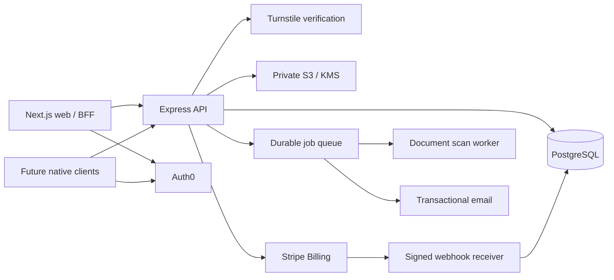

# BrainCraze implementation specification

## Status and scope

This is a proposed implementation plan based on the supplied BrainCraze brief. It is not evidence that an application exists or that any integration works. The initial repository was empty. Production readiness requires implementation, integration tests, deployment validation, and operational review.

The account and verification system serves responsive web clients and a versioned API usable by future native mobile clients. Building native iOS or Android applications is a separate deliverable. GPA calculation, study partner matching, clubs, marketplace, posts, and analytics are entitlement destinations in this scope; their underlying products are not specified by this brief.

Required: accounts, verified email, human verification, institution affiliation review, free/premium selection, protected access, account security, billing, and administrator review. Optional: PayPal. University SSO is conditional on actual institutional availability and agreements. No university directory, SSO connection, or email-domain trust list is assumed to exist.

## Proposed technical decisions

Use Next.js, React, and Tailwind for web; Express on Node.js for the API; PostgreSQL for application data; Auth0 for identity; Stripe Billing for subscriptions; private AWS S3 with KMS for verification documents; Cloudflare Turnstile for human verification. Auth0 and Turnstile are selections from the alternatives in the brief, not existing configured integrations. Keep provider adapters so hCaptcha or Firebase can be evaluated later without treating them as interchangeable implementations.

Auth0 owns password storage, password reset, email verification, MFA, and identity-provider connections. Do not create a second password database in PostgreSQL. The brief's `password_hash` column is unnecessary under managed identity and should be omitted. Verify whether the selected Auth0 plan and custom email provider support the requested six-digit email-code flow before committing to that exact UX; a hosted verification-link flow is not equivalent. This is an unresolved provider capability requirement, not a feature to simulate.

Use authorization code with PKCE. Web uses a backend-for-frontend session with an HttpOnly, Secure, SameSite cookie and server-held tokens; avoid browser localStorage for tokens. Native clients use system-browser authorization and OS secure storage. The API validates JWT signature, issuer, audience, expiry, and allowed algorithms using cached provider keys. Enable refresh-token rotation and reuse detection. Application authorization comes from current database state, not self-selected registration fields or stale JWT claims.

## Architecture and trust boundaries



The API is the only application writer to verification, roles, entitlements, and billing state. A durable shared rate-limit/session store and job queue must be selected and configured before multi-instance deployment; Redis is a proposed option. Workers scan quarantined uploads before reviewer access. Browser success screens, storage upload completion, payment redirects, and client booleans never grant access.

All provider credentials stay server-side. Only explicitly public provider identifiers reach the browser. Use a secret manager and environment-specific configuration. No credentials have been requested, supplied, or validated by this document.

## Account state and access policy

Represent independent facts rather than one overloaded verification boolean: email verification, human verification, affiliation verification, account standing, and subscription selection. Derive the next onboarding step on the server in this order:

1. Anonymous → register or sign in.
2. Email unverified → email verification.
3. Human verification missing → human challenge.
4. Affiliation not approved → school verification or pending/rejected status.
5. Plan not selected → subscription selection.
6. Active account with completed onboarding → dashboard.

Verification success is a summary between affiliation approval and plan selection. Pending document review does not unlock the dashboard. A rejected user receives an actionable reason and can resubmit. A request for more information keeps access gated. Reverification policy and expiry duration require a product decision; do not invent a permanent-affiliation guarantee.

Free is an explicit plan selection. Premium is granted only after a verified Stripe event establishes the applicable active entitlement. Resolve trials, payment-failure grace periods, refund effects, and cancellation timing as documented product policies before launch. Until decided, do not grant premium on incomplete or past-due payments. Cancellation should default to period end with the effective date shown before confirmation.

Registration offers Student, Faculty, Teaching Assistant, Tutor, and Staff. Administrator is a privileged assignment made by an authorized administrator or audited bootstrap operation, with MFA required. Never allow registration, profile editing, or a school-role dropdown to create administrator access. Record academic role separately from administrative privileges.

The API checks account standing and onboarding state on every protected request. Premium endpoints additionally check current server entitlements. Administrative endpoints require an explicit permission and MFA/step-up policy. Suspended/banned users lose access and relevant sessions are revoked. UI route guards supplement, but do not replace, API checks.

## Screen wireframes and behavior

Use a shared responsive shell: clear page title, compact progress indicator, one primary action, inline validation, accessible status announcements, and support navigation. On desktop use a centered form with a contextual side panel; on mobile use a single column without horizontal scrolling. Forms preserve non-secret input across recoverable errors. Never preserve passwords or ID images in localStorage.

| Screen | Layout and controls | Required states and transitions |
| --- | --- | --- |
| Sign up | Name, username, email, password/confirmation, searchable school, academic role; optional major/minor/year/photo; password-strength feedback; Google/Microsoft/Apple and available institution sign-in | Validate on server; explain uniqueness failures without leaking account existence in recovery flows; provider errors and unavailable connections are explicit; continue to verified-email gate |
| Login | Email/password, remember-me, recovery link, configured social providers | Hosted identity flow; MFA challenge where enabled; redirect to server-computed next step; remember-me has a defined session policy |
| Email verification | Six-digit code input when supported by identity provider, submit and resend with cooldown | Expired/wrong code, rate limit, resend success; account-bound single use; never accept a client email-verified claim |
| Human verification | Turnstile challenge and clear instructions | Server verifies token, expected hostname/action, expiry and single-use behavior; challenge failure, retry, inaccessible-network path |
| School verification | Searchable curated school selector, academic role, university email, method choice | Only configured domains can use university-email verification; selecting a school or typing `.edu` is insufficient; upload/camera routes available |
| Upload ID | Front-of-ID upload for JPG/PNG/PDF; clear/privacy instructions; file-name and scan status | Size/type validation, quarantine, scan failures, pending review, rejected/resubmit; no public asset URL |
| Camera capture | Permission request, positioning guide, live preview, capture, review, retake, upload | HTTPS-only camera use; denied/unavailable camera falls back to upload; stop tracks on exit; same security pipeline as uploaded files |
| Verification success | Approved school and academic role, appropriate badge, continue action | Render server-issued badge only; pending review cannot reach this state |
| Subscription selection | Free and Premium cards; $7.99 monthly / $69.99 yearly; feature lists from brief | Select Free or server-created Stripe Checkout; show currency, taxes and renewal terms; return page waits for server confirmation |
| Billing | Current plan/status, renewal/end date, payment history, invoices, payment-method action | Authorized Stripe portal; upgrade/downgrade/cancel/renew with effective dates; no raw card data enters application servers |
| Account settings | Profile, security, privacy, verification, subscription sections | Photo/banner upload separate from identity documents; session revocation, password reset, MFA management; privacy does not hide records from authorized safety review |
| Admin review | Metrics, paginated queue with user/school/role/method/submitted date, detail drawer, approve/reject/request-information | Search/filter; privileged document preview; reason required for adverse decisions; concurrency conflicts handled; all decisions audited |

Verified badges appear on profile, search, posts, and marketplace through one shared badge renderer backed by server-issued data. Those surfaces must honor privacy and authorization. “Verified” means approved academic affiliation, not endorsement or professional certification.

Accessibility acceptance: keyboard-complete navigation, visible focus, meaningful labels and error associations, sensible focus on route/error changes, adequate contrast, no status conveyed by color alone, screen-reader announcements, reduced-motion support, and manual mobile/zoom checks. Target WCAG 2.2 AA; do not claim conformance without an audit.

## Component and file architecture

```text
apps/
  web/                    # Next.js routes, BFF, responsive UI
    app/(auth)/           # registration, login, recovery, callbacks
    app/onboarding/       # email, human, school, documents, success, plans
    app/(protected)/      # dashboard, settings, billing
    app/admin/            # review and management screens
    components/           # accessible forms, progress, badges, plan cards
  api/                    # Express routes and middleware
    src/auth/             # JWT checks, permissions, sessions
    src/verification/     # gates, email proofs, upload finalization, review
    src/subscriptions/    # checkout, portal, webhook, entitlements
    src/admin/            # moderation and audit
    src/providers/        # identity, human verification, email, S3, Stripe
  worker/                 # scanning, notifications, retention cleanup
packages/
  contracts/              # shared request/response validation
  database/               # migrations, typed queries, transaction helpers
  ui/                     # reusable accessible primitives
tests/
  integration/            # real test database and provider boundary tests
  e2e/                    # complete user journeys
infra/                    # deployment and least-privilege policies
docs/                     # threat model, runbooks, product decisions
```

Use shared DTOs without exposing database records directly. Provider adapters must fail closed when unconfigured. Test fixtures and sandbox integrations must be visibly separated from production; never display a fake successful payment, email delivery, school approval, or CAPTCHA result as a real result.

## Proposed database schema

Use UUID primary keys, UTC timestamptz, foreign keys, explicit status constraints, and indexed ownership/filter fields. Implement these definitions as reviewed migrations; the list below is a model specification, not an executed schema.

| Relation | Fields and constraints |
| --- | --- |
| users | id; identity_issuer + identity_subject unique; first_name; last_name; normalized username unique; normalized email unique under defined identity-linking policy; academic_role; school_id nullable until selected; account_status; email_verified_at; human_verified_at; subscription_selected_at; created_at; updated_at |
| profiles | id; user_id unique FK; profile_photo_key; banner_key; bio; major; minor; graduation_year; privacy enum public/friends/private |
| schools | id; school_name; active; timestamps |
| school_domains | id; school_id FK; normalized_domain unique; verification_policy; approved_at; approved_by; no wildcard trust by default |
| affiliation_email_challenges | id; user_id FK; school_id FK; normalized_email; token_hash; expires_at; consumed_at; failed_attempts; issued_at; bind proof to user and school |
| verification_requests | id; user_id FK; academic_role; school_id FK; method enum university_email/upload/camera; document_id nullable; status enum pending_scan/pending_review/needs_information/approved/rejected/superseded; submitted_at; reviewed_at; reviewer_id; decision_reason; version |
| verification_documents | id; owner_user_id FK; private object_key unique; detected_media_type; byte_size; checksum; scan_status; retention_deadline; deleted_at; encryption_key_reference (identifier only) |
| verification_badges | id; user_id FK; verification_request_id FK; badge_type; issued_at; revoked_at; expires_at nullable; unique active badge policy |
| subscriptions | id; user_id unique FK; stripe_customer_id unique nullable; stripe_subscription_id unique nullable; plan enum free/premium_monthly/premium_yearly; provider_status; current_period_end; cancel_at_period_end; updated_at |
| payments | id; user_id FK; stripe_invoice_id unique; amount_minor integer; currency; provider; status; paid_at; created_at; do not store card details |
| webhook_events | provider + event_id unique; processing_status; received_at; processed_at; sanitized error; retention-bound event payload where necessary |
| admin_permissions | user_id FK; permission; granted_by; granted_at; unique(user_id, permission) |
| admin_logs | id; admin_id FK; action; target_type; target_id; reason; request_id; timestamp; append-only service policy |
| sessions | id; user_id FK; hashed session identifier; encrypted server token reference; expires_at; revoked_at; created_at; last_seen_at |
| reports | id; reporter_id; subject_type; subject_id; reason; status; reviewed_by; timestamps |
| outbox_jobs | id; kind; payload reference; deduplication_key unique; status; attempts; next_attempt_at; timestamps |

Approval must transactionally check reviewer permissions and request version, update request state, supersede incompatible prior approvals, issue/revoke badges, and insert an audit event. Avoid duplicate active requests with a database uniqueness policy. Admin log deletion and edits are denied to ordinary application roles. Payment money uses integer minor units and explicit currency; advertised prices need configured Stripe price IDs, not client-submitted amounts.

## API contracts

Return structured JSON errors with stable codes, field errors where applicable, and request IDs. Enforce request size limits, schema validation, pagination and ownership filters. Apply CSRF protections to cookie-authenticated mutations. Never place secrets, tokens, document URLs, or ID contents in logs.

| Endpoint | Contract and protection |
| --- | --- |
| POST /api/auth/register | Begin managed identity registration; validate profile metadata; academic role only; provider handles password hashing; prevent partial account state with idempotent provisioning |
| POST /api/auth/login | Begin hosted login, not local password comparison; social/university flow uses provider connection and PKCE |
| POST /api/auth/logout | Revoke server session and clear cookie; expose explicit current/all-session policy |
| POST /api/auth/reset-password | Generic response, provider-backed recovery, strict abuse limits |
| GET /api/auth/me | Current identity, academic role, permissions, gates, subscription state; exclude private document metadata |
| POST /api/verification/email | Verify provider-supported email challenge; refresh trusted provider state; no client override |
| POST /api/verification/email/resend | Account-bound resend, cooldown and daily abuse limit |
| POST /api/verification/captcha | Verify Turnstile server-side with secret and expected action/hostname; record short-lived proof |
| GET /api/schools?q= | Paginated curated directory; no fabricated institutions or domains |
| POST /api/verification/school | Require verified email and human gate; bind school/role/method; university email starts an expiring challenge; document methods start review flow |
| POST /api/verification/school/confirm-email | Consume hashed, expiring single-use challenge; verify configured school-domain policy before issuing affiliation |
| POST /api/verification/upload-id | Create bounded upload intent for quarantined object; method upload; no public bucket ACL |
| POST /api/verification/camera-scan | Same server pipeline with camera provenance; no automatic authenticity claim |
| POST /api/verification/documents/:id/finalize | Verify ownership, object size/signature/checksum; enqueue scan idempotently; do not approve affiliation |
| GET /api/verification/status | User's current gates, request status, safe reviewer feedback, and resubmission eligibility |
| GET /api/subscription/current | User's server subscription and entitlement state |
| POST /api/subscription/free | Record explicit free selection after verification |
| POST /api/subscription/upgrade | Require completed verification; accept allowlisted plan ID; create Stripe Checkout with idempotency and server-resolved price |
| POST /api/subscription/cancel | Authorized period-end cancellation with idempotency; show provider-confirmed effective date |
| POST /api/subscription/portal | Authenticated customer-specific billing portal session; allowlisted return URL |
| POST /api/webhooks/stripe | Raw request body signature verification; deduplicate event IDs; reconcile against current Stripe object state to tolerate delivery reordering |
| GET /api/billing/invoices | Authorized invoice history and authenticated download action; no cross-customer access |
| PATCH /api/account/profile | Field allowlist; never accept permissions, verification, or subscription fields |
| GET/DELETE /api/account/sessions[/:id] | Only owned sessions; support revocation and managed identity constraints |
| POST /api/account/mfa | Provider-supported enrollment/management with recent authentication |
| GET /api/admin/verifications | Permission/MFA-gated paginated queue and filters |
| GET /api/admin/verifications/:id/document | Authorized, audited short-lived private access after clean scan; no public URL |
| POST /api/admin/approve | Request ID and expected version; transactional decision, badges, audit |
| POST /api/admin/reject | Same concurrency checks; required safe reason |
| POST /api/admin/request-information | Required feedback and notification; request remains unapproved |
| POST /api/admin/users/:id/suspend or /ban | Dedicated moderation permission; audited reason; revoke sessions |
| GET /api/admin/metrics | Aggregate totals from application state with explicit definitions |
| GET/PATCH /api/admin/reports/:id | Authorized report queue and resolution |
| POST /api/admin/users/:id/subscription-portal | Separate billing permission and audited support workflow; never arbitrary client entitlements |

## Verification, upload, and privacy controls

University email verification requires actual mailbox possession and an approved exact-domain mapping. Domain matching must use normalized domain equality and the public suffix/IDN policy, not suffix substring checks. A school email alone may not establish faculty, tutor, or staff status; configure which roles each proof can support. Unsupported role proofs require review. School-directory curation and role-evidence policy remain launch prerequisites.

Uploads use generated object keys; original filenames never determine paths. Define and enforce a documented maximum size (proposed 10 MiB) on upload intent, object finalization and scanner processing. Validate MIME plus file signatures, reject unexpected formats, limit image dimensions/PDF pages and decompression resources, scan for malware, strip unnecessary image metadata, and safely rasterize previews. Preserve the original only when retention policy requires it. Scanner failure is quarantine, not approval.

S3 blocks public access and uses server-side KMS encryption with scoped roles; enforce TLS and bucket policy. Separate quarantine/clean prefixes or buckets. Only the owner can submit/finalize their own documents, and only authorized reviewers can view clean documents. Use short-lived reviewer access, no caching, controlled content disposition, and audited reads. Do not expose IDs on profiles, search results, logs, analytics, error reporting, or notification emails.

Agree document retention, deletion, backups, data residency, legal basis, reviewer staffing and appeal policy before production. Do not invent regulatory certification. Delete expired artifacts via lifecycle/worker policy and verify that derived previews and applicable backups follow the documented retention approach.

## Billing workflow

Create actual Stripe products and monthly/yearly prices in test mode first. The displayed $7.99/$69.99 comes from the brief; currency, taxes, supported territories, and live merchant configuration need confirmation. Credit/debit cards, Apple Pay and Google Pay depend on the merchant account, browser/device, domain registration and Stripe availability; do not promise that every option appears on every device. PayPal is optional and needs separate supported-provider evaluation.

Use hosted Stripe Checkout and Customer Portal. Handle subscription creation/updates/deletion and paid/failed invoice events as appropriate to the pinned Stripe API version. Verify webhook signatures with the raw body and correct environment secret. Use database event deduplication, durable retries, and provider reconciliation; do not assume event ordering or exactly-once delivery. Return success only after durable acceptance. Retry/reconcile failed events with operational visibility.

Keep free/premium entitlements centralized. Upgrades, downgrades, proration, renewal, cancellation reversal, failed payment, refund and dispute behavior need explicit tests and visible effective dates. Invoice downloads must be tied to the authenticated customer's actual invoice. Never synthesize payment history.

## Security and operations

Validate all boundary inputs; parameterize database access; restrict CORS; set CSP and security headers; enforce HTTPS, CSRF protection where cookies authenticate, request limits, distributed rate limits and abuse monitoring. Use separate rate limits for login/recovery, verification-code attempts, resends, uploads and privileged actions. Redact personal information in traces.

Define session idle/absolute expiry, recent-auth requirements, MFA recovery, identity linking and account deletion policies. Never link accounts solely because an untrusted identity supplies the same email. Verify provider email trust and require authenticated linking.

Deploy separate development/staging/production Auth0 tenants or isolated clients, Stripe modes, databases, storage and secrets. Pin supported runtime/dependency versions during implementation, commit lockfiles, and run frozen installs. Do not claim a version has been checked until installed and tested. Apply least-privilege service roles, database backups and restore drills, monitoring, queue failure handling, migration rollback strategy, and dependency/security scanning.

## Implementation order and completion evidence

1. Bootstrap web/API/workers, schema migrations, configuration validation, health endpoints, and local PostgreSQL; document tested commands and lock dependencies.
2. Integrate Auth0 in its real test tenant; implement provisioning, sessions, recovery, MFA, authorization and onboarding gates. Resolve the exact email-code requirement before calling email verification complete.
3. Add curated schools, Turnstile verification, university-email proofs and the private document pipeline; exercise actual storage and scan boundaries.
4. Build reviewer workflow and badge propagation with audit and concurrency handling; seed an admin through a controlled operational command.
5. Integrate Stripe test-mode checkout, portal, signed webhooks, invoice history and entitlement transitions; use real sandbox events.
6. Complete responsive screens, profile/privacy controls, session management and admin moderation/report actions.
7. Run meaningful integration and end-to-end tests, accessibility checks, threat-model review, load/abuse checks, restore/deletion exercises and staging deployment validation. Resolve critical findings before live use.

| Acceptance area | Required evidence |
| --- | --- |
| Registration | Actual managed identity account; unique username handling; social-provider callbacks tested only for configured connections |
| Gate order | Direct API and route access fail before each required gate; selecting admin in payload cannot escalate privileges |
| Email/human proofs | Wrong, expired, replayed and cross-account proofs rejected; provider outage does not grant verification |
| Affiliation | Approved-domain mailbox proof works; fabricated domains fail; role evidence policy enforced; rejected requests can resubmit |
| Documents | Valid JPG/PNG/PDF pipeline; disguised/oversize/malicious files blocked; unauthenticated/cross-user access denied; encryption configuration checked |
| Reviewer | Non-admin forbidden; MFA enforced; competing approvals handled; decisions and document reads audited |
| Billing | Stripe sandbox payment, signed duplicate/reordered webhook, failed payment, cancellation, renewal and invoice ownership tested |
| Sessions/security | Logout/revocation, MFA, recovery, CSRF, JWT validation, object-level authorization and rate limits exercised |
| UI | Phone/desktop layouts; keyboard and screen-reader journeys; camera denial fallback; pending/error states visible |
| Operations | Fresh setup tested; migrations repeatable; workers restart; backup restore, retention/deletion and monitoring validated |

No tests have been run for these features because application code does not yet exist. Provider credentials, configured callbacks/webhooks, approved school directory, mailbox delivery, scan infrastructure and product/legal policies remain necessary before live validation.
